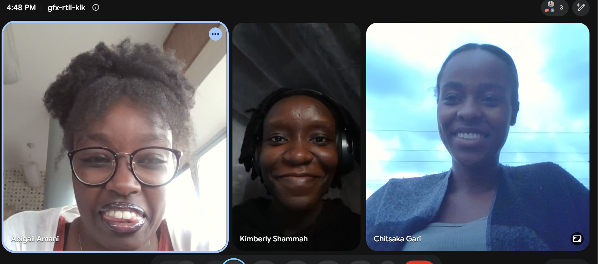

# PS-Agents: Agent Design 

**Group 8 
## Question 1 
> Design the agent using the PEAS framework and further define its environment using the 5 definitions of agent environments.

### The Agent 
-	The agent in the medical tracking app for parents with children is an assistant. It runs inside the application and helps parents keep their child’s health records 
-	It 
* Stores each child’s visit, growth and immunisation records on the phone.
* Works out which immunisation is due for each child from the Kenya Expanded Programme on immunisation (KEPI) schedule.
* Sends reminders before the dose is due
* Answers parents’ questions in both Swahili and English 

### PEAS Frame work 
|Elements |	Definition | 
|---|---|
| **Performance measures** |<ul><li>Immunisation and reminders are correct and on time</li><li>Visit and growth records are stored accurately</li></ul>| 
| **Environment** |<ul><li>Clinics and health centres</li><li>Parents and their children</li><li>English and Swahili setting</li></ul>| 
| **Actuators** 	|<ul><li>Push notification and reminders</li><li>Chat reply</li><li>Screen navigation</li><li>Language switch</li></ul>| 
| **Sensors** 	|<ul><li>Touch and keyboard input</li><li>Phone date</li><li>Stored history in the database</li></ul>|

### Environment Properties 
|Property |	Classification | 	Why |
|---|---|---|
| **Observability** | Partially observable |	The agent only knows what the parent has entered. It does not have access to doses given that are not recorded. It also cant see the child’s real health, so it works from incomplete state | 
| **Determinism** | Stochastic |	The KEPI due calculation is deterministic.The output of any action depends on things the agent cant control like whether the parent acts on the reminder or not.|
| **Episodic vs sequential** | Sequential |	Decisions depends on the history. Whether the next vaccination is available for the child depends entirely on the doses already given to the child. Each recorded visits changes the next notification | 
| **Static vs Dynamic**| Dynamic |	Environment keeps on changing. Time passes ang doses become due or overdue. Connectivity comes and goes and profile status keep on changing |
| **Discrete vs Continuous**| Mostly Discrete |	Doses, age, visits and schedules are discrete. Time and growth measures are continuous | 
---

## Evidence of group work 
### Team Photo 

